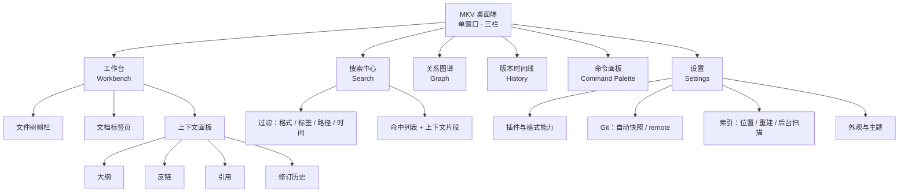
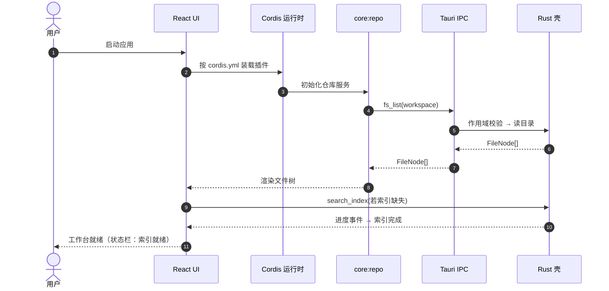
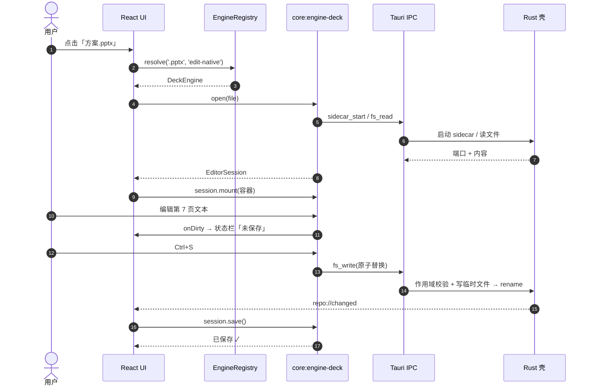
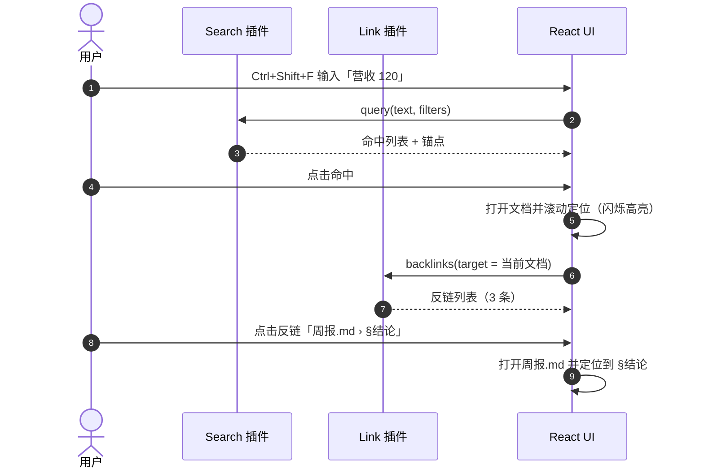
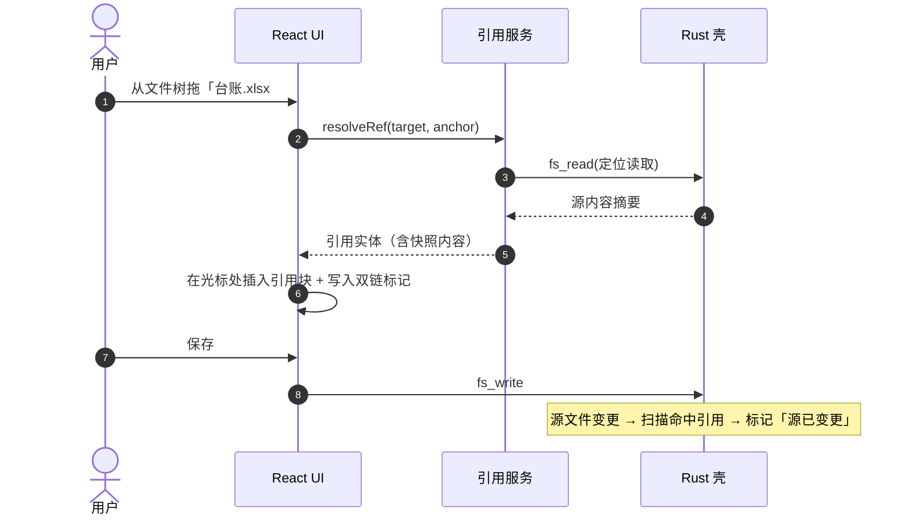
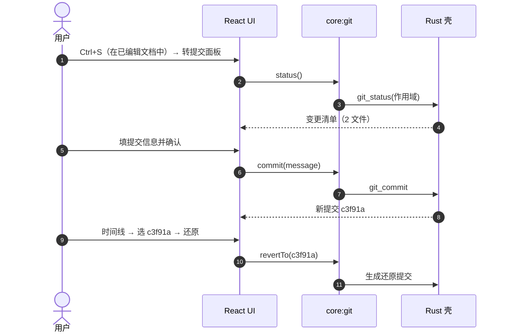

# MKV 原型图 · Prototype v1.0

> **输入文档**：[`docs/本地个人知识库-需求描述.md`](../本地个人知识库-需求描述.md) v1.0 · [`docs/mkv-architecture.md`](../mkv-architecture.md) v1.0（设计定稿）
> **定位**：低保真交互原型 + 视觉规范（不含最终像素稿）。用于对齐信息架构、页面状态、交互流与组件语言。
> **图形版**：[`prototype.html`](./prototype.html)（自包含图册，浏览器直接打开）· 线框 SVG 见 [`svg/p01..p11-*.svg`](./svg/) · 图索引 [`index.html`](./index.html)
> **配套**：[`02-详细设计.md`](./02-详细设计.md)（结构与契约）· [`README.md`](./README.md)（索引与图例）
> **范围外**：Web 端 / 多人协同 / 云端账号（需求 §7 明确不做）；语义·向量检索（远期）。

---

## 1. 设计目标（从需求反推）

| # | 设计目标 | 需求来源 | 原型如何体现 |
| :-- | :-- | :-- | :-- |
| G1 | **一个入口管理全部知识**：不切换工具、不换应用 | §3 P0 统一知识入口 | 左栏统一文件树 + 标签页 + 命令面板，三面板单窗口 |
| G2 | **找到即到达**：搜索命中 → 跳到原文精确位置 → 立即看反链 | §5.2 §5.3 | 搜索结果带上下文片段，点击后定位并联动右栏反链 |
| G3 | **预览与编辑同页**：不做「预览窗 / 编辑器」割裂 | 架构 §6 统一容器 | 文档区同一位置按格式分发渲染器，能力降级只换呈现不改布局 |
| G4 | **格式可插拔**：新增格式不改宿主 | 架构 §1「一切皆插件」 | 渲染层用统一 `EditorSession` 契约占位，缺失即空态+引导安装 |
| G5 | **Git 可见**：演进史像文件一样可读 | §3 P0 §5.5 | 标题栏常驻分支与提交入口，右栏「历史」页签给出时间线与 diff |
| G6 | **降级不阻断**：插件未装 / 只读 / 索引重建中，主流程仍可用 | 需求 §6 可观测；P1 决策 D1 | 每页定义空/载/错/只读四态；顶栏全局进度条 |
| G7 | **本地主权**：任何操作不出机器 | §1 三优先 §6 安全 | UI 不出现云端入口；设置中仅提供「可选私有 remote」 |

---

## 2. 信息架构

### 2.1 导航结构



### 2.2 视图清单与路由

| 视图 ID | 名称 | 路由 | 主要数据来源 | 出现于 |
| :-- | :-- | :-- | :-- | :-- |
| V-1 | 工作台 | `#/workbench` | `repo` 插件 · `engines` 注册表 | 默认首屏 |
| V-2 | 搜索中心 | `#/search?q=` | `search` 插件（SQLite FTS5） | `Ctrl+Shift+F` / 命令面板 |
| V-3 | 关系图谱 | `#/graph` | `core:link` 插件（双链图） | 右栏「图谱」入口 |
| V-4 | 版本时间线 | `#/history` | `core:git` 插件 | 标题栏提交按钮旁 |
| V-5 | 命令面板 | 浮层 | 全局命令注册表 | `Ctrl+K` |
| V-6 | 设置 | `#/settings` | `settings_*` 命令 | 右上齿轮 |

> **说明**：架构文档（v1.0 定稿）的插件清单为 `core:repo / core:engine-onlyoffice / core:engine-block / core:engine-base / core:engine-pdf / core:search / core:ui-shell`，**未含 Git、双链/反链、图谱三类插件**，而这三项是需求 §3 P0 的硬性能力。本原型据此预留了 V-4 与 V-3，并把「Git / 双链」作为待补插件列入 [`02-详细设计.md` §17 待决项](./02-详细设计.md#17-风险与待决项)。

---

## 3. 全局骨架

### 3.1 应用主窗口

```text
┌────────────────────────────────────────────────────────────────────────────────────────────────┐
│ ● MKV   知识库: D:/Docs/MyVault   [main ⌄]      [⬆ 提交 3 处改动]   [CtrlK 搜索命令]    [⚙] [─][□][×] │ ← 标题栏 44px
├──────────────┬──────────────────────────────────────────────────────────┬──────────────────────────┤
│ ① 资源侧栏    │ ② 标签页栏  方案.pptx ×   台账.xlsx ×   ＋                │ ③ 上下文面板              │
│ 240–320px    ├──────────────────────────────────────────────────────────┤ 280–360px                │
│              │                                                          │                          │
│ [🔍 过滤文件] │  ┌────────────────────────────────────────────────────┐  │ [大纲][反链][引用][修订]  │
│              │  │  跨格式引用条                                        │  │                          │
│ ▾ 需求       │  │  ⬡ 台账.xlsx › 2024Q1 › B2「营收 120 万」   ⟳ 已变更  │  │ ▾ 大纲                   │
│   ▪ 需求.md  │  ├────────────────────────────────────────────────────┤  │   1. 背景                │
│   ▪ 台账.xlsx│  │                                                    │  │   2. 目标                │
│ ▾ 方案       │  │                 文档工作区（渲染器按格式分发）        │  │ ▾ 反链 (3)               │
│   ▪ 方案.pptx│  │                                                    │  │   · 周报.md › §结论      │
│   ▪ 流程.vsdx│  │                 ┌─ 格式能力条 ─────────────┐       │  │   · 复盘.md › L42        │
│ ▾ 归档       │  │                 │ 模式:编辑 ▾  引擎:deck  │       │  │ ▾ 引用 (2)               │
│   ▪ 旧版.docx│  │                 └─────────────────────────┘       │  │   · 方案.pptx › p.7     │
│              │  │                                                    │  │                          │
│ [+ 新建文件]  │  │  (预览 = 编辑 同一页面)                          │  │ [反向插入 · 拖拽到此]    │
│              │  └────────────────────────────────────────────────────┘  │                          │
│              │ ◀◀ 命中 3 / 12 ▶▶   已保存 ✓(12:04)   [预览|编辑|分栏]     │                          │
├──────────────┴──────────────────────────────────────────────────────────┴──────────────────────────┤
│ ✓ 索引就绪 12,480 篇 · Git 工作区干净 · 插件 5/6 可用 · 后台扫描中 34% · 全部文件本地，无网络请求   │ ← 状态栏 28px
└────────────────────────────────────────────────────────────────────────────────────────────────┘
```

### 3.2 布局规则

| 区域 | 尺寸 | 规则 |
| :-- | :-- | :-- |
| 标题栏 | 高 44px | 常驻分支选择器 + 提交状态 + 命令面板入口 |
| ① 侧栏 | 宽 240–320px，可拖拽 | 文件树 / 搜索结果 / 图谱 三态复用同一容器（切换不重建侧栏） |
| ② 主区 | 自适应，最小 480px | 标签页栏 + 文档工作区 + 底部命中导航条 |
| ③ 右栏 | 宽 280–360px，可折叠 | 随选中项联动；无选中项时显示「大纲」 |
| 状态栏 | 高 28px | 索引/Git/插件/扫描四类状态常驻，错误才升级为警示色 |

### 3.3 三栏显隐

| 操作 | 效果 |
| :-- | :-- |
| `Ctrl+B` | 折叠/展开左栏 |
| `Ctrl+J` | 折叠/展开右栏 |
| 双击标题栏空白 | 折叠全部侧栏（专注模式） |
| 拖拽分隔条 | 调整宽度，宽度持久化到 `settings_set` |

---

## 4. 页面原型

### P-1 工作台（默认首屏）

**目的**：一屏完成「找文件 → 看内容 → 追关系 → 存版本」。
**入口**：应用启动 / 命令面板 `工作台`。

```text
┌──────────────┬──────────────────────────────────────────────────┬──────────────────────────┐
│ 文件树        │ 标签页: [方案.pptx ×][台账.xlsx ×][＋]            │ 大纲 | 反链 | 引用 | 修订 │
│ ┌──────────┐ │ ┌──────────────────────────────────────────────┐ │ ┌──────────────────────┐ │
│ │🔍 过滤…  │ │ │ 引用条: ⬡ 台账.xlsx#Sheet1!B2  ⟳ 源已变更   │ │ │ ▾ 反链 (3)           │ │
│ └──────────┘ │ ├──────────────────────────────────────────────┤ │ │  周报.md › §结论     │ │
│ ▾ 需求       │ │                                              │ │ │  复盘.md › L42       │ │
│  需求.md     │ │   [ 幻灯片渲染 · 第 7 / 24 页 ]              │ │ │ ▾ 引用 (2)           │ │
│  台账.xlsx   │ │                                              │ │ │  方案.pptx › p.7     │ │
│ ▾ 方案       │ │      ┌───────────────┐                        │ │ │                      │ │
│  方案.pptx   │ │      │   第 7 页缩略  │                        │ │ │  [反向插入 ▾]       │ │
│  流程.vsdx   │ │      │   （可点选元素）│                        │ │ └──────────────────────┘ │
│ ▾ 归档       │ │      └───────────────┘                        │ │                          │
│  旧版.docx   │ │  ┌──────────────────────────────────────┐    │ │                          │
│              │ │  │ 能力条: 模式[编辑▾] 引擎[deck 0.16]  │    │ │                          │
│ [＋ 新建]    │ │  │        ⇩ 导出 · ⇱ 另存 · ⤢ 聚焦      │    │ │                          │
│              │ │  └──────────────────────────────────────┘    │ │                          │
└──────────────┴──────────────────────────────────────────────────┴──────────────────────────┘
```

| 区域 | 元素 | 交互 | 视觉（Miro 令牌） |
| :-- | :-- | :-- | :-- |
| 引用条 | 引用源类型图标 + 定位串 + 变更标记 | 点击→在源文档定位；`⟳`→查看 diff | 背景 coral `#ffc6c6` / 文字 `#600000`，圆角 10px |
| 文档工作区 | 渲染器容器 | 双击进入编辑；编辑/预览同位切换 | 白底 + ring shadow `rgb(224,226,232) 0 0 0 1px` |
| 能力条 | 模式、引擎名、导出/另存 | 引擎缺失→禁用并给「安装」 | 按钮 outlined `1px #c7cad5`，8px 圆角 |
| 右栏页签 | 大纲/反链/引用/修订 | 反链计数为徽标 | 选中态文字 `#1c1c1e`，未选 `#555a6a` |

**降级行为**：未安装对应引擎 → 文档区显示占位卡（图标 + 格式名 + 「安装 XX 插件」按钮），**保留引用条与右栏反链**，保证双链链路不断。

---

### P-2 文件树侧栏

**目的**：统一知识入口；感知库结构与文件类型。

```text
┌────────────────────────────┐
│ [🔍 过滤文件…            ] │
│ ─────────────────────────  │
│ ▾ 📁 需求            12    │
│   📄 需求.md         md     │
│   📊 台账.xlsx       xlsx   │
│   📽 方案.pptx       pptx   │
│   📄 智能文档.docxxml docxxml│
│   🗂 台账.base        base   │
│ ▾ 📁 方案             8    │
│   📄 流程.vsdx       vsdx   │
│   📐 架构.drawio     drawio │
│ ▸ 📁 归档             31    │
│ ─────────────────────────  │
│ [＋ 新建] [⇅ 排序] [⟳ 刷新]│
└────────────────────────────┘
```

| 交互 | 行为 |
| :-- | :-- |
| 单击 | 选中并打开预览 |
| 双击 | 打开标签页并进入编辑 |
| 右键 | 菜单：重命名 / 移动 / 复制 / 删除 / 在资源管理器中显示 / Git 记录 |
| 拖拽文件到文档区 | 插入引用（生成动态引用而非复制） |
| 拖拽文件到右栏「反向插入」 | 生成反向链接 |
| `[[` 输入 | 模糊匹配补全（文件/标题/块三级） |
| 文件夹前角标 | 该文件夹内存在未提交改动时显示圆点（`#5b76fe`） |

---

### P-3 文档工作区（预览 = 编辑同页）

**目的**：统一容器，按格式分发渲染器（需求 §5.4）。

```text
┌──────────────────────────────────────────────────────────────┐
│ 模式: [预览|编辑|分栏]        锚点: 2.3 / 目标设备          │ ← 能力条
├──────────────────────────────────────────────────────────────┤
│                                                              │
│   # 目标与范围                                               │
│   正文段落……（编辑态为可编辑块，CtrlB 加粗、CtrlShiftX 插入引用）      │
│                                                              │
│   ▸ 引用：[[台账.xlsx]] 的 B2（营收 120 万）  ← 内联双链      │
│                                                              │
│   [ 代码块 #锚点 ]                                           │
│                                                              │
└──────────────────────────────────────────────────────────────┘
```

**按格式的呈现差异（同一容器内的分发规则）**

| 格式 | 渲染器 | 交互要点 | 只读原因 |
| :-- | :-- | :-- | :-- |
| Markdown | 内置 Md 编辑器（块编辑） | 块级锚点、拖拽引用 | — |
| DocxXML | `core:engine-block`（TipTap 块模型） | 标题/高亮块/代码块/公式 | 插件缺失 |
| Base | `core:engine-base`（多维表格） | 单元格编辑、字段视图 | 插件缺失 |
| Excel | `core:engine-onlyoffice` / 表格渲染 | 区域→单元格双击编辑 | 插件缺失 |
| PPT | 幻灯片渲染 | 左侧缩略图 + 页面内元素 | 插件缺失 |
| Word | 文档渲染 | 章节树 + 段落 | 插件缺失 |
| PDF | `core:engine-pdf`（pdf.js） | 缩放/页码/批注 | 天然只读 |
| Drawio / Visio | 只读抽取适配器 | 节点高亮、点击节点看引用 | 天然只读 |

**统一锚点模型**（点击来源时必须能定位）：

| 格式 | 锚点串 | 例 |
| :-- | :-- | :-- |
| Markdown | `path#heading` / `path#block:<id>` | `方案/周报.md#结论` |
| Base | `path#record:<id>` | `台账.base#record:rec_01` |
| Excel | `path#<sheet>!<cell>` 或 `path#<sheet>!<c1>:<c2>` | `台账.xlsx#Sheet1!B2` |
| PPT | `path#p:<n>` / `path#p:<n>@<element>` | `方案.pptx#p:7` |
| Word | `path#<heading>` / `path#para:<id>` | `旧版.docx#第二章` |

---

### P-4 跨格式引用条（引用视图）

**目的**：表达「引用是动态的，不是复制」（需求 §5.3）。

```text
┌──────────────────────────────────────────────────────────────────────┐
│ ⬡ 引用自  台账.xlsx › 2024Q1 › B2   「营收 120 万」   ⟳ 源已变更 v3 │
│    快照：营收 120 万（2024-11-02 提交）     [查看差异] [定位到源] [断开引用] │
└──────────────────────────────────────────────────────────────────────┘
```

| 状态 | 视觉 | 含义 |
| :-- | :-- | :-- |
| 最新 | teal `#c3faf5` / 文字 `#187574` | 引用内容与源一致 |
| 已变更 | coral `#ffc6c6` / 文字 `#600000` + `⟳` | 源更新过，引用处可「刷新」或保留快照 |
| 失效 | red `#fbd4d4` | 源文件被删除/移动；提供「重定位」 |

**操作**：`⟳` 刷新 → 用源最新内容替换（写回当前文档，产出可 diff 的变更）；`查看差异` → 打开内联 diff 视图。

---

### P-5 搜索中心

**目的**：跨格式全文检索 + 精确跳转（需求 §5.2）。

```text
┌───────────────┬──────────────────────────────────────────────────────────────┐
│ 过滤          │  搜索框: [ 营收 120 ] [格式: ☑全部 ☐xlsx ☐pptx ☐docx]           │
│ ───────────  │           [标签: 财务] [路径: 需求/] [时间: 近30天] [正则 ⚡]   │
│ 格式         │ ─────────────────────────────────────────────────────────────│
│  ☑ 全部      │  12 个结果 · 耗时 38ms · 已索引 12,480 篇                      │
│  ☐ xlsx (3)  │ ┌──────────────────────────────────────────────────────────┐ │
│  ☐ pptx (2)  │ │ 1. 台账.xlsx › 2024Q1 › B2                    [xlsx]      │ │
│  ☐ docx (5)  │ │    …预计 **营收 120** 万，同比 +12%…          ⟵ 命中高亮 │ │
│  ☐ md (2)    │ └──────────────────────────────────────────────────────────┘ │
│ 标签         │ ┌──────────────────────────────────────────────────────────┐ │
│  ☑ 财务      │ │ 2. 方案.pptx › p.7                            [pptx]      │ │
│  ☐ 产品      │ │    …Q1 **营收 120** 万达成情况…                             │ │
│ 时间范围     │ └──────────────────────────────────────────────────────────┘ │
│  [近30天 ▾]  │  …                                                          │
└───────────────┴──────────────────────────────────────────────────────────────┘
```

| 元素 | 规则 |
| :-- | :-- |
| 结果项 | 标题（文档 › 定位串）+ 类型徽标 + **上下文片段**（命中词高亮，蓝色 `#5b76fe` 底） |
| 点击结果 | 打开标签页 → 滚动并闪烁定位命中处 → 右栏自动切到「反链」 |
| 过滤器 | 与检索请求同一表达式下推（格式/标签/路径/时间），过滤结果与总数实时更新 |
| 正则开关 | 开启后输入框边框转 `#5b76fe`，非法表达式给出行内错误并禁用检索（需求 P2 已落地正则） |
| 空结果 | 「未命中」+ 一键「以当前词建立全文检索别名 / 检查索引状态」 |

---

### P-6 双链与反链

```text
内联双链（文档区）：
  ▸ 见 [[台账.xlsx#Sheet1!B2]]，其值为 120 万
     ↑ 悬停：显示目标摘要卡片（标题/首段/反链数）；点击：打开并高亮定位

右栏「反链」页签：
  ┌────────────────────────────────────────┐
  │ 反向链接 (3)          [按时间排序 ▾]   │
  ├────────────────────────────────────────┤
  │ ● 周报.md › §结论                       │
  │   “营收 120 万” · 2 天前 · 未提交       │
  │ ● 复盘.md › L42                         │
  │   “见 [[台账.xlsx#Sheet1!B2]]” · 5 天前 │
  │ ● 归档/2023.md › 第 4 段               │
  │   已失效（源文件已移动）                │
  └────────────────────────────────────────┘
```

- 反链条目 = 一次「引用关系」的实体（源文档、锚点、上下文句、修改时间、Git 状态）。
- **双向打通**（需求 §5.3）：搜到 → 跳转 → 右栏反链 → 点反链跳到引用处，形成闭环。

---

### P-7 关系图谱

```text
┌───────────────────────────────────────────────────────────────┐
│ [布局: 力导向|树形] [深度: 2] [聚焦: 当前文档] [过滤: 仅 md]    │
├───────────────────────────────────────────────────────────────┤
│                                                               │
│        (周报.md)──引用──▶(台账.xlsx)◀──引用──(方案.pptx)       │
│            │                                                   │
│         引用                                                  │
│            ▼                                                   │
│       (复盘.md)                                                │
│                                                               │
│   ● 当前文档  ● 被引用  ○ 仅显示邻域   ◆ 失效链接（虚线）      │
└───────────────────────────────────────────────────────────────┘
```

- 节点 = 文档；边 = 引用关系（区分「双向互引 / 单向 / 已失效」）。
- 交互：单击节点 → 右侧预览；双击 → 打开文档；框选 → 批量建立关系视图。
- 规模保护：默认只展开当前文档 2 度邻域，避免万级节点一次性渲染。

---

### P-8 版本时间线（Git）

```text
┌──────────────────────────────────────────────┬──────────────────────────────┐
│ 时间线                                      │ diff:  方案.pptx               │
│  ● c3f91a  2026-11-10 11:02  自动快照        │ ───────  c3f91a                │
│    │  修订单价计算口径                        │ +  营收 120 万 → 138 万        │
│  ● 8a2b10  2026-11-09 18:41  手动提交        │ -  营收 120 万                │
│    │  更新 Q1 台账                            │ ───────  8a2b10                │
│  ● 5d0e44  2026-11-08 09:15  自动快照        │ (无差异)                      │
│    ○ 初始导入                                │                              │
├──────────────────────────────────────────────┤ [还原到此版本] [检出为分支]   │
│ [⟳ 全部历史] [仅当前文件] [按作者 ⌄]         │                              │
└──────────────────────────────────────────────┴──────────────────────────────┘
```

| 交互 | 行为 |
| :-- | :-- |
| 自动快照 | 可配频率（默认 10 分钟 + 空闲触发），在时间线标「自动快照」 |
| 手动提交 | `Ctrl+S` 唤起提交面板（信息 + 变更清单 + 勾选） |
| diff | 文本类逐行 diff；二进制（xlsx/pptx）给出结构化摘要（工作表/页数/单元格变更） |
| 回滚 | 「还原到此版本」生成一次新提交（不丢历史），符合 Git 安全约束 |

---

### P-9 命令面板

```text
┌────────────────────────────────────────────────────────────────┐
│ 🔍 输入命令或文件名…                                            │
├────────────────────────────────────────────────────────────────┤
│ › 提交：方案.pptx 的改动                     CtrlEnter  文件 · 2 处改动│
│ › 在台账中查找「营收 120」                   CtrlShiftF  搜索           │
│ › 打开 台账.xlsx                             CtrlO   文件           │
│ › 新建 Markdown 文档                         CtrlN   文件           │
│ › 插入引用…                                  CtrlShiftR  编辑           │
│ › 重建索引                                   AltR   索引           │
│ › 安装插件：Deck（PPTX 引擎）                CtrlP   插件           │
└────────────────────────────────────────────────────────────────┘
```

- 统一入口，聚合「文件 / 命令 / 插件 / 设置项」四类候选（后两类是 P1 动态注册的来源）。
- 键盘：`↑↓` 选择、`Enter` 执行、`Esc` 关闭、`Ctrl+1..9` 直选。

---

### P-10 设置

```text
┌──────────────────┬──────────────────────────────────────────────────────────┐
│ 通用             │ 插件与格式能力                                           │
│ 外观与主题   ●   │ ┌──────────────────────────────────────────────────────┐ │
│ Git              │ │ 插件            格式      能力      状态             │ │
│ 索引与扫描       │ │ deck (PPTX)     .pptx    编辑·渲染  ✔ 已启用 v0.16   │ │
│ 插件与格式       │ │ block           .docxxml 编辑·渲染  ✔ 已启用         │ │
│ 快捷键           │ │ base            .base    编辑·渲染  ⚠ 实验性         │ │
│                  │ │ pdf             .pdf     渲染      ✔ 已启用         │ │
│                  │ │ extract-drawio  .drawio  抽取(只读) ✔ 已启用        │ │
│                  │ │ office (docx/xlsx/pptx)      ✖ 未安装 [安装]        │ │
│                  │ └──────────────────────────────────────────────────────┘ │
│                  │ [从本地安装 .dll]  [检查更新]  [打开插件目录]           │
└──────────────────┴──────────────────────────────────────────────────────────┘
```

- **Git 设置**：自动快照开关与频率、是否在关闭时提交、`remote`（可选私有仓库，留空即纯本地）。
- **索引设置**：索引存储位置、后台扫描开关与间隔、排除规则（`.gitignore` 语法）、重建按钮。
- **安全**：全量本地加密（可选）、不联网上报（明示）。

---

### P-11 降级与异常态

| 场景 | 呈现 | 恢复路径 |
| :-- | :-- | :-- |
| 引擎插件未安装 | 文档区居中占位卡：格式图标 + 「需要 XX 插件才能预览」+ [安装] | 安装后原地热加载并渲染 |
| 引擎加载失败（动态库异常） | 占位卡 + 错误摘要 + 「查看日志」 | 打开日志目录 / 重试加载 |
| 文档为只读（FS 权限/外部占用） | 顶栏黄条「只读模式」+ 复制为副本入口 | 另存副本 |
| 索引重建中 | 状态栏进度 + 搜索结果标注「结果可能不完整」 | 可中断 / 后台继续 |
| 索引损坏 | 搜索页错误态 + 「一键重建索引」 | 重建（要求可重建，Git 内索引可 `git checkout` 恢复） |
| Git 未初始化 | 时间线页空态：「此文件夹还不是 Git 仓库 [初始化]」 | 初始化（仅本地，无 remote 亦可用） |
| 引用失效（源被删/改名） | 引用条红色 + 「重定位到…」 | 选择新路径 |
| 外部编辑器占用文件 | 保存失败提示 + 重试 | 重试 / 另存 |

---

## 5. 页面状态矩阵

| 页面 | 空态 | 加载态 | 错误态 | 只读/降级 |
| :-- | :-- | :-- | :-- | :-- |
| 工作台 | 未打开知识库 → 选择文件夹 / 新建 | 骨架屏（文件树 + 文档区） | 库路径不可读 | 插件缺失 → 占位卡 |
| 文件树 | 无文件 → 新建/导入 | 懒加载子树 | 目录读取失败 | 部分子目录不可读 |
| 文档区 | 未选择文档 → 引导 | 渲染骨架 | 解析失败 → 降级为纯文本 | 只读横幅 |
| 搜索 | 无查询词 → 提示与最近搜索 | 结果流式追加 | 索引不可用 → 重建引导 | 部分格式未索引（明示覆盖范围） |
| 反链 | 无引用 → 「尚无双链」 | — | 关系数据损坏 → 重建索引 | 失效链接单独归组 |
| 图谱 | 无关系 → 引导创建引用 | 渐进渲染 | 规模超限 → 降深度 | 过滤后为空 |
| 时间线 | 非 Git 仓库 → 初始化引导 | 载入提交中 | Git 冲突/锁 | 无 remote 时仅本地 |

---

## 6. 交互流程

### 6.1 首次打开知识库



### 6.2 打开并编辑一份 PPT（引擎为插件）



### 6.3 搜索 → 跳转 → 反链 → 顺藤摸瓜



### 6.4 插入跨格式引用（拖拽 / `@`）



### 6.5 Git 提交与回滚



---

## 7. 视觉规范（基于 Miro Design System）

### 7.1 颜色令牌

| 用途 | 令牌 | 色值 | 用法 |
| :-- | :-- | :-- | :-- |
| 主文本 | Near Black | `#1c1c1e` | 标题与正文 |
| 次文本 | Slate | `#555a6a` | 辅助说明、路径、计数 |
| 占位符 | Input Placeholder | `#a5a8b5` | 输入框占位、禁用态 |
| 画布 | White | `#ffffff` | 主背景 |
| 交互主色 | Blue 450 | `#5b76fe` | 主按钮、命中高亮、选中态、链接 |
| 按下态 | Actionable Pressed | `#2a41b6` | 主按钮按下 |
| 成功 | Success | `#00b473` | 已保存、索引就绪 |
| 边框 | Border | `#c7cad5` | outlined 按钮、分隔线 |
| Ring | Ring shadow | `rgb(224,226,232) 0 0 0 1px` | 卡片/输入框「阴影即描边」 |
| 强调（浅） | Coral / Teal / Rose / Orange / Pink / Red | `#ffc6c6` `#c3faf5` `#ffd8f4` `#ffe6cd` `#fde0f0` `#fbd4d4` | 状态条、徽标、卡片底色 |
| 强调（深） | Coral Dark / Teal·Moss Dark / Yellow Dark | `#600000` `#187574` `#746019` | 浅色底上的文字色 |

> 规则：每屏最多使用 2 种 pastel 强调；状态色（成功/警示/错误）不与品牌 pastel 混用。

### 7.2 字体层级

| 角色 | 字体 | 字号 | 字重 | 行高 | 字距 |
| :-- | :-- | :-- | :-- | :-- | :-- |
| Hero（首屏标题） | Roobert PRO Medium | 56px | 400 | 1.15 | -1.68px |
| 区块标题 | Roobert PRO Medium | 48px | 400 | 1.15 | -1.44px |
| 卡片标题 | Roobert PRO Medium | 24px | 400 | 1.15 | -0.72px |
| 子标题 | Noto Sans | 22px | 400 | 1.35 | -0.44px |
| 特性行 | Roobert PRO Medium | 18px | 600 | 1.35 | normal |
| 正文 | Noto Sans | 18px | 400 | 1.45 | normal |
| 正文标准 | Noto Sans | 16px | 400–600 | 1.50 | -0.16px |
| 按钮 | Roobert PRO Medium | 17.5px | 700 | 1.29 | 0.175px |
| 说明 | Roobert PRO Medium | 14px | 400 | 1.71 | normal |
| 小字 | Roobert PRO Medium | 12px | 400 | 1.15 | -0.36px |
| 微标（胶囊标签） | Roobert PRO | 10.5px | 400 | 0.90 | uppercase |

- 显示字体使用 OpenType 变体：`"blwf","cv03","cv04","cv09","cv11"`；正文字体 `"liga" 0,"ss01","ss04","ss05"`。

### 7.3 组件样式

| 组件 | 规格 |
| :-- | :-- |
| 主按钮 | 蓝底 `#5b76fe`、白字、8px 圆角、内边距 7px 12px、字重 700 |
| 次按钮 | 透明底、`1px solid #c7cad5`、8px 圆角、7px 12px 内边距 |
| 圆形图标按钮 | 50% 圆角、白底 + 轻阴影，直径 32–40px |
| 卡片 | 圆角 12–24px，浅色 pastel 底 + ring shadow，无重投影 |
| 输入框 | 白底、`1px solid #e9eaef`、8px 圆角、16px 内边距；聚焦时边框转 `#5b76fe` |
| 徽标 | 10.5px uppercase 微标，圆角 4–8px，pastel 底 + 深色字 |
| 状态条 | 圆角 10px，左侧 4px 色条（成功 `#00b473` / 警示 / 错误 `#fbd4d4`） |
| 层级/分隔 | 只用 1px 描边与背景色差区分，不叠加阴影 |

### 7.4 间距与圆角

- 间距基线：1 / 2 / 4 / 8 / 12 / 16 / 20 / 24 px；区块内边距 16–24px，页面外边距 24–40px。
- 圆角：按钮/输入 8px、卡片 10–12px、面板 20–24px、大容器 40–50px。

### 7.5 响应式断点

`425 / 576 / 768 / 896 / 1024 / 1200 / 1280 / 1366 / 1700 / 1920`

| 断点 | 行为 |
| :-- | :-- |
| < 1024 | 右栏折叠为抽屉；标签页保留 |
| < 768 | 左栏默认折叠，标题栏保留分支与命令面板 |
| ≥ 1366 | 三栏全展开，文档区最大宽度 1200px 居中（长文可读性） |

---

## 8. 快捷键

| 域 | 快捷键 | 动作 |
| :-- | :-- | :-- |
| 全局 | `Ctrl+K` | 命令面板 |
| 全局 | `Ctrl+Shift+F` | 搜索中心 |
| 全局 | `Ctrl+P` | 快速打开文件 |
| 全局 | `Ctrl+S` | 保存 /（文档区外）打开提交面板 |
| 全局 | `Ctrl+B` / `Ctrl+J` | 折叠左栏 / 右栏 |
| 全局 | `Ctrl+Shift+G` | 关系图谱 |
| 文件 | `Ctrl+N` | 新建文档 |
| 文件 | `F2` / `Delete` | 重命名 / 删除 |
| 编辑 | `Ctrl+Shift+R` | 插入引用 |
| 编辑 | `[[` | 触发双链补全 |
| 导航 | `Alt+↑/↓` | 上/下一个命中 |
| 导航 | `Ctrl+Tab` | 切换标签页 |

---

## 9. 原型 ↔ 需求追踪

| 需求条目 | 覆盖原型 | 状态 |
| :-- | :-- | :-- |
| §3 P0 统一知识入口 | P-1、P-2 | 已覆盖 |
| §3 P0 全文检索 + 精确跳转 | P-5、§6.3 | 已覆盖 |
| §3 P0 多格式预览（8 种） | P-3 格式分发表、P-11 | 覆盖 8 种（5 引擎 + PDF + 只读抽取适配器）；引擎缺失统一降级 |
| §3 P0 Markdown 双链 / 反链 / 图谱 | P-6、P-7 | 已覆盖 |
| §3 P0 Git 版本 | P-8 | 已覆盖（依赖待补 `core:git` 插件） |
| §3 P1 跨格式引用 | P-4、§6.4 | 已覆盖 |
| §3 P1 标签/元数据检索 | P-5 过滤区 | 已覆盖 |
| §3 P1 外部唤起 + 可独立更新插件 | P-10、P-11 | 已覆盖 |
| §5.2 过滤（格式/标签/路径/时间） | P-5 | 已覆盖 |
| §5.3 引用变更标记 | P-4 状态列 | 已覆盖 |
| §6 可观测（进度与失败提示） | 状态栏、§4 各状态、P-11 | 已覆盖 |
| §7 边界（不做 Web/协同） | 全局：无 Web 入口、无协同入口 | 已覆盖 |
