# MKV 详细设计 · Detailed Design v1.0

> **输入文档**：[`docs/本地个人知识库-需求描述.md`](../本地个人知识库-需求描述.md) v1.0 · [`docs/mkv-architecture.md`](../mkv-architecture.md) v1.0（设计定稿）
> **图形版**：[`detailed-design.html`](./detailed-design.html)（自包含图册，浏览器直接打开）· 设计图 SVG 见 [`svg/fig-*.svg`](./svg/) · 图索引 [`index.html`](./index.html)
> **配套**：[`01-原型图.md`](./01-原型图.md)（交互与视觉）· [`README.md`](./README.md)（索引与图例）
> **标注约定**：`【文档】` = 直接来自输入文档 · `【补充】` = 本文为闭合需求新增的设计（须评审确认）

---

## 1. 设计基线

### 1.1 范围

| 维度 | 内容 | 来源 |
| :-- | :-- | :-- |
| 形态 | 本地离线桌面应用（Windows 优先），无云端依赖 | 架构 §1 / 需求 §7 |
| 技术定调 | Cordis 插件内核 + Tauri 2 桌面壳 + React UI | 架构 §定调 |
| 存储 | `.docx/.xlsx/.pptx/.docxxml/.base/.pdf` + Drawio/Visio 只读抽取 | 需求 §4 / 架构 §1 |
| 三大原则 | 本地优先 / 文件优先 / Git 优先 | 需求 §1 |
| 明确不做 | Web 端、多人协同、云端 SaaS、账号体系 | 需求 §7 |
| 远期 | 语义/向量检索、本地 LLM | 需求 §7 |

### 1.2 关键约束（不可妥协）

1. **Rust 壳是唯一拥有系统权限的一层**；Cordis 运行在 WebView 渲染进程，OS 能力一律经 Tauri 命令获取（架构 §2）。
2. **一切文件读写限定在工作区路径作用域内**（架构 §2 / §5）。
3. **UI 层不感知格式差异**：格式能力由 `EngineRegistry.resolve(ext, capability)` 决定渲染/编辑/外跳（架构 §3.3）。
4. **索引可一键重建**（需求 §6），知识库整体 = 一个文件夹（需求 §6 可移植）。
5. **不向第三方上传任何内容**（需求 §6 安全）。

### 1.3 术语表

| 术语 | 定义 |
| :-- | :-- |
| 仓库 Workspace | 知识库根目录，即 Git 仓库根 |
| 文档 Document | 仓库内一个可识别文件及其元数据 |
| 引擎 Engine | 提供某格式「渲染/编辑」能力的插件单元 |
| 抽取器 Extractor | 只读解析某格式、产出纯文本与结构锚点的插件单元（需求 P1「1 个只读抽取适配器」原则） |
| 会话 EditorSession | 一次文档打开的运行时实例，承载 mount/save/close/dirty |
| 锚点 Anchor | 文档内可定位位置的结构化引用（`#Sheet1!B2`、`#p:7`、`#结论`） |
| 引用 Reference | 源文档 → 目标锚点的动态引用实体（含快照与变更状态） |
| 双链 Link | 由 `[[文档]]` 或 `@引用` 语法解析出的链接记录 |

---

## 2. 系统上下文

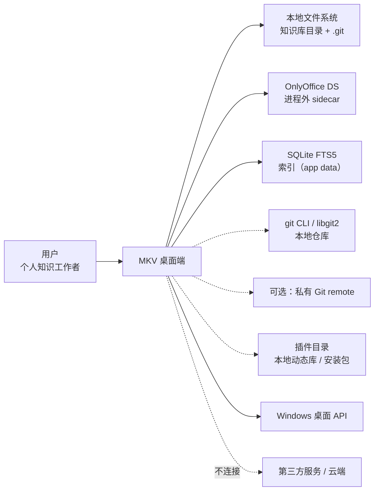

- 实线 = 必需依赖；虚线 = 可选或降级路径。
- **NET 仅允许「插件更新检查 / 可选 Git remote」两条出网路径**，其余一律本地（需求 §6）。

---

## 3. 分层与进程架构

### 3.1 总体分层【文档 + 补充】

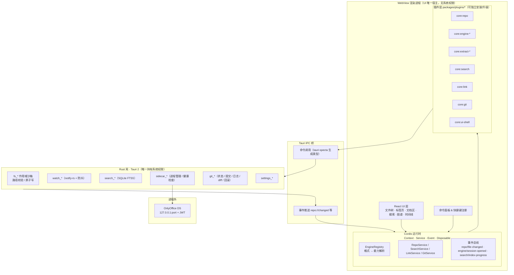

**依赖方向铁律**：`UI → Cordis → 插件 → Tauri IPC → Rust 壳`。反向只允许**事件**（Rust → 事件总线 → 订阅者），不允许反向命令调用。

### 3.2 进程边界与信任等级

| 进程 | 信任等级 | 能做什么 | 不能做什么 |
| :-- | :-- | :-- | :-- |
| WebView（UI + Cordis + 插件 JS/TS） | 半可信 | 渲染、调用 IPC 命令 | 直接触碰文件系统 / 启动进程 / 网络 |
| Rust 壳 | 完全可信 | 受限 fs、监听、子进程、SQLite、Git | 越过工作区作用域 |
| OnlyOffice sidecar | 外部组件 | 渲染/编辑 Office 文档 | 访问工作区外路径（由 Rust 侧只读投喂） |
| 第三方插件（动态库/包） | 不受信 | 通过受控 API 提供能力 | 绕过沙箱；须经签名/权限声明校验 |

### 3.3 Cordis Host / Client 拆分【文档】

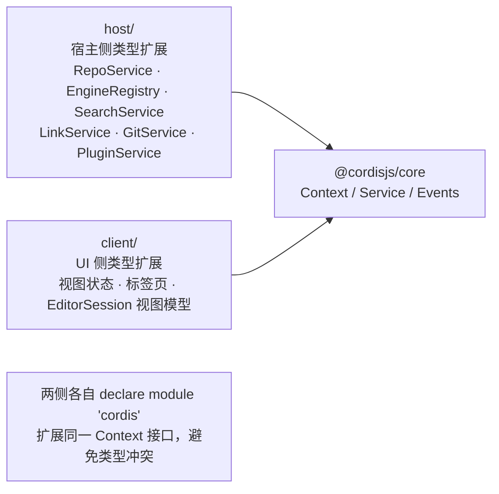

- 插件实现放 `packages/plugins/*`（pnpm workspace monorepo，架构 §4）。
- 宿主能力 = 注入 Context 的 Service；插件能力 = 订阅事件 + 注册 Service。

---

## 4. 组件与能力矩阵

### 4.1 插件清单

| 插件 | 职责 | 格式 | 能力 | 依赖 Tauri 命令 | 来源 |
| :-- | :-- | :-- | :-- | :-- | :-- |
| `core:repo` | 文件树、变更监听、重命名/移动/删除 | 全部 | 文件操作 | `fs_*` `watch_*` | 【文档】 |
| `core:engine-pdf` | pdf.js 渲染、页码/缩放/批注 | `.pdf` | view | `fs_read` | 【文档】 |
| `core:engine-block` | TipTap + 飞书块 JSON 双向序列化 | `.docxxml` | edit-native | `fs_read/write` | 【文档】 |
| `core:engine-base` | 多维表格 + xlsx 互通 + `.base` 导入器 | `.base` | edit-native / view | `fs_*` | 【文档】 |
| `core:engine-onlyoffice` | sidecar 生命周期 + 嵌入 DS 编辑器 + JWT 回调 | `.docx/.xlsx/.pptx` | edit-adapter | `sidecar_*` `fs_*` | 【文档】 |
| `core:engine-deck`【补充】 | 幻灯片轻量渲染与编辑（DTO 子集） | `.pptx` | edit-native / view | `fs_*` | 对应需求 P1「6 个编辑器插件」 |
| `core:engine-word`【补充】 | 文档轻量渲染与编辑（DTO 子集） | `.docx` | edit-native / view | `fs_*` | 同上 |
| `core:engine-grid`【补充】 | 表格轻量渲染与编辑（DTO 子集） | `.xlsx` | edit-native / view | `fs_*` | 同上 |
| `core:engine-md`【补充】 | Markdown WYSIWYG + 块级锚点 | `.md` | edit-native | `fs_*` | 需求 §3 P0 双链载体 |
| `core:extract-drawio`【补充】 | 只读抽取（节点/边/标签） | `.drawio` | extract（只读） | `fs_read` | 需求 §3 P2 节点级引用 |
| `core:extract-visio`【补充】 | 只读抽取 | `.vsdx` | extract（只读） | `fs_read` | 同上 |
| `core:search` | 索引调度：抽取 → 写 SQLite FTS5 | 全部 | 检索 | `search_*` | 【文档】 |
| `core:link`【补充】 | 双链解析、反链维护、关系图谱数据 | `.md` 为主 | 关系 | `search_*` `fs_read` | 需求 §3 P0 缺口 |
| `core:git`【补充】 | 状态、提交、日志、diff、回滚 | 全部 | 版本 | `git_*` | 需求 §3 P0 缺口 |
| `core:ui-shell` | 设置、主题、i18n、命令面板注册 | — | UI | `settings_*` | 【文档】 |

> 需求 P1「6 个编辑器插件 + 1 个只读抽取适配器」的落位：`deck / word / grid / block / base / md` 六个编辑插件 + `extract-*` 只读抽取族；`pdf` 独立为查看器插件，`onlyoffice` 为可选重编辑器。命名与数量需评审（见 §17 待决项 D-6）。

### 4.2 格式 × 能力矩阵（最终版）

| 格式 | 预览 | 编辑 | 引用粒度 | 主引擎 | 降级链 |
| :-- | :-- | :-- | :-- | :-- | :-- |
| `.xlsx` | ✅ 表格 | ✅ 单元格 | 单元格 / 区域 | `engine-grid` | `engine-onlyoffice` → 外部唤起 |
| `.pptx` | ✅ 幻灯片 | ✅ 页/元素 | 页级 | `engine-deck` | `engine-onlyoffice` → 外部唤起 |
| `.docx` | ✅ 文档 | ✅ 章节/段落 | 章节/段落级 | `engine-word` | `engine-onlyoffice` → 外部唤起 |
| `.docxxml` | ✅ 原生 | ✅ 块级 | 块级 | `engine-block` | 纯文本只读 |
| `.base` | ✅ 原生 | ✅ 记录/块 | 记录/块级 | `engine-base` | xlsx 互通导出 |
| `.pdf` | ✅ | ❌ 只读 | 页级 | `engine-pdf` | — |
| `.drawio` | ✅ 只读 | ❌ | 节点级 | `extract-drawio` | — |
| `.vsdx` | ✅ 只读 | ❌ | 节点级 | `extract-visio` | — |
| `.md` | ✅ | ✅ 块级 | 标题/代码块/列表项 | `engine-md` | 纯文本只读 |

**降级链规则**：`EngineRegistry.resolve(ext, want)` 按 `want` 返回引擎；未命中则 UI 依次尝试 `edit-native → edit-adapter → view → 外部唤起`，仍不可用则展示占位卡并保留引用/反链信息（原型 P-11）。

---

## 5. 运行时机制

### 5.1 插件生命周期

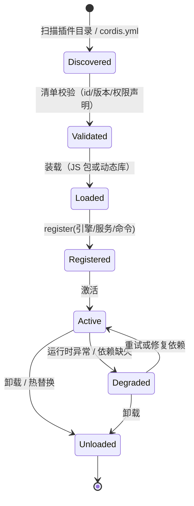

- **注册表**：`EngineRegistry.register(engine): Disposable`，卸载即释放订阅与命令。
- **能力探测**：插件声明 `formats: [{ ext, capability }]`；宿主据此决定「可编辑 / 只读 / 外跳」（架构 §3.3）。
- **失败隔离**：单个插件崩溃不得影响宿主与其他插件（`try/catch` + 错误事件上报）。

### 5.2 事件总线

| 事件 | 载荷 | 触发者 | 订阅者 |
| :-- | :-- | :-- | :-- |
| `repo/file-changed` | `{ path, kind, ts }` | `core:repo` | 文件树、搜索索引、link 插件 |
| `engine/session-opened` | `EditorSession` | 引擎插件 | UI（挂载）、状态栏 |
| `engine/session-dirty` | `{ path, dirty }` | 引擎插件 | 状态栏、自动快照 |
| `search/index-progress` | `{ done, total, phase }` | `core:search` | 状态栏进度条 |
| `search/index-ready` | `{ count, ms }` | `core:search` | 状态栏、搜索页 |
| `link/graph-updated` | `{ edges }` | `core:link` | 图谱视图 |
| `git/status-changed` | `{ branch, dirtyCount }` | `core:git` | 标题栏、文件树角标 |
| `plugin/state-changed` | `{ id, state }` | 插件管理器 | 设置页、占位卡 |
| `repo://changed`（Tauri 事件） | `{ path }` | Rust 壳 | `core:repo` |

### 5.3 命令注册

- 命令面板条目由插件在 `core:ui-shell` 注册，字段：`{ id, title, category, shortcut, run }`。
- 内置命令示例：`file.open` `file.create` `file.rename` `search.focus` `graph.show` `git.commit` `index.rebuild` `plugin.install`。

---

## 6. 关键时序设计

### 6.1 打开文档（能力解析 → 会话挂载）

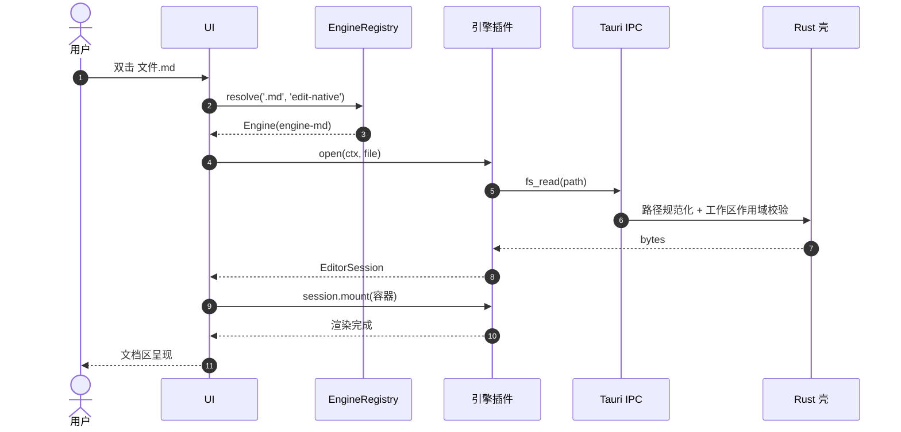

**降级分支**：若 `resolve` 依次失败，UI 直接走「外部唤起」（`fs_read` + 系统默认程序）或占位卡（原型 P-11）。

### 6.2 保存（原子替换 + 监听回环）

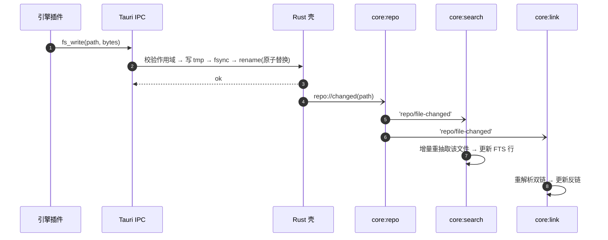

- 写回期间 **抑制自触发回环**：Rust 侧记录「本次写入路径 + 时间戳」，监听器在窗口内忽略自事件，或由 `core:repo` 维护 `pendingWrites` 集合做去重。

### 6.3 后台索引与检索

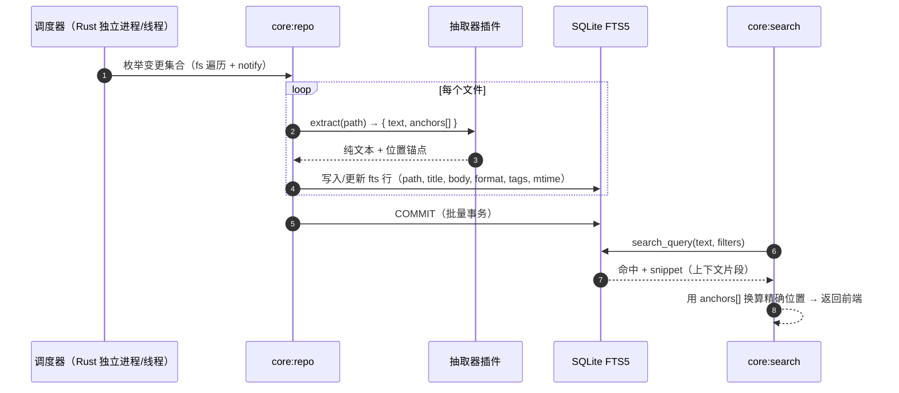

### 6.4 双链解析与反链维护

```mermaid
sequenceDiagram
  autonumber
  participant Doc as 文档内容
  participant Link as core:link
  participant Repo as core:repo
  participant DB as 关系库（links / backlinks 表）

  Repo->>Link: 'repo/file-changed'(path)
  Link->>Doc: fs_read + 解析正文
  Doc->>Link: 抽出 [[目标#锚点]] / @引用 / 嵌入块
  Link->>DB: 删除该文档的旧出链
  loop 每条链接
    Link->>DB: 写入出链 + 反向登记（目标文档 ← 源文档）
    alt 目标不存在
      Link->>DB: 标记 status = 'broken'（待重定位）
    end
  end
  DB-->>Link: 更新完成
  Link-)UI: 'link/graph-updated'
```

### 6.5 插件安装与加载

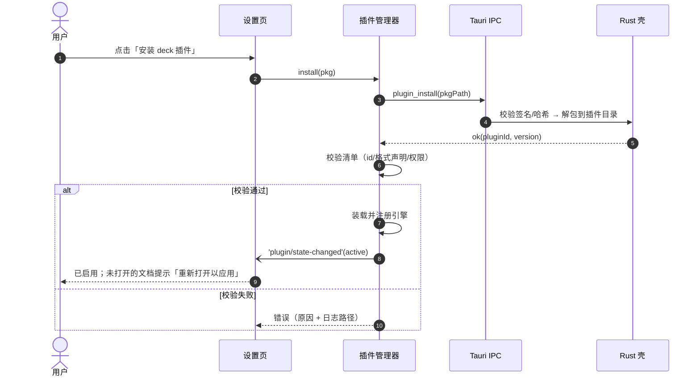

### 6.6 Git 提交与回滚

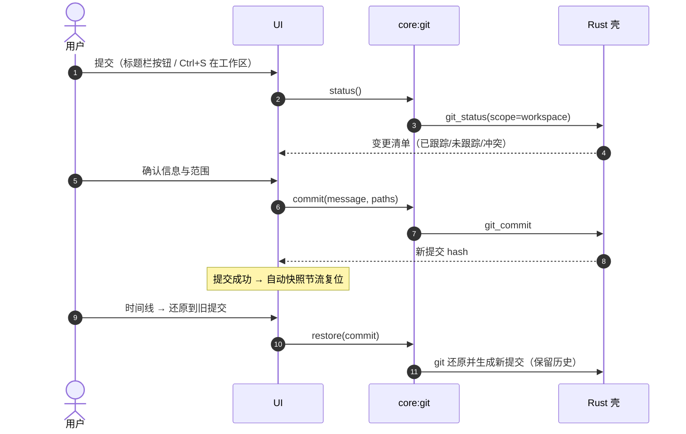

---

## 7. 数据模型

### 7.1 领域实体

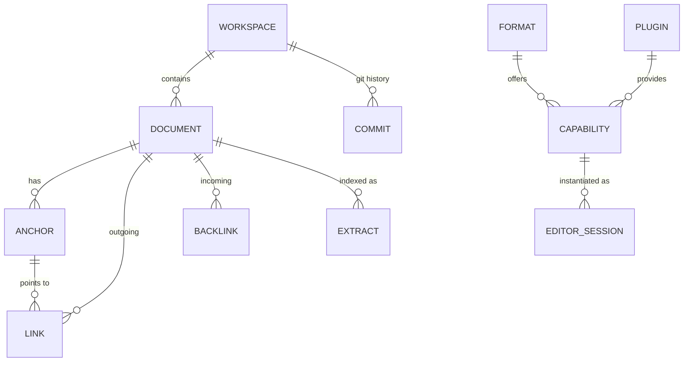

### 7.2 实体字段

| 实体 | 关键字段 | 说明 |
| :-- | :-- | :-- |
| `Document` | `path`(PK, 相对工作区)、`format`、`title`、`size`、`mtime`、`git_status`、`extractor_version` | 文件本体元数据 |
| `Anchor` | `doc_path`、`anchor_id`、`kind`(heading/cell/slide/para/record/node)、`locator`、`snippet` | 文档内可定位位置 |
| `Link`（出链） | `src_path`、`dst_path`、`anchor_id`、`syntax`(`[[]]`/`@`/embed)、`context`、`created_at` | 一条引用关系 |
| `Backlink` | `dst_path`、`src_path`、`anchor_id`、`context`、`status`(live/broken/stale)、`resolved_at` | 反向链接（由 Link 派生） |
| `Extract`（索引行） | `doc_path`、`title`、`body`、`format`、`tags`、`path_prefix`、`mtime`、`anchors_json` | 供 FTS5 与定位使用 |
| `Commit` | `hash`、`author`、`date`、`message`、`files_changed`、`snapshot_type`(auto/manual) | Git 时间线 |
| `EditorSession` | `session_id`、`doc_path`、`engine_id`、`capability`、`dirty`、`mounted_at` | 运行时会话（内存态） |
| `PluginRecord` | `id`、`version`、`state`、`formats[]`、`permissions[]`、`checksum` | 插件清单与状态 |

### 7.3 索引表结构（SQLite FTS5）【补充】

```sql
-- 文档索引：FTS5 虚拟表
CREATE VIRTUAL TABLE doc_fts USING fts5(
  path UNINDEXED,     -- 相对工作区路径
  title,              -- 标题 / 首行 / 幻灯片标题
  body,               -- 正文 + 内嵌文本（Excel 文本、PPT 文字、Word 正文）
  format UNINDEXED,   -- xlsx / pptx / docx / docxxml / base / pdf / md / ...
  tags UNINDEXED,     -- 逗号分隔标签
  mtime UNINDEXED,
  anchors_json        -- 位置映射：[{ text, locator }]
);

-- 链接关系表（双链与反链）
CREATE TABLE links (
  src_path   TEXT NOT NULL,
  dst_path   TEXT NOT NULL,
  anchor_id  TEXT,
  syntax     TEXT NOT NULL,     -- wikilink | at | embed
  context    TEXT,
  status     TEXT NOT NULL DEFAULT 'live',  -- live | broken | stale
  updated_at INTEGER NOT NULL,
  PRIMARY KEY (src_path, dst_path, anchor_id, syntax)
);

-- Git 提交缓存（时间线展示用，避免每次走 git）
CREATE TABLE commits (
  hash TEXT PRIMARY KEY,
  author TEXT, date INTEGER, message TEXT,
  files_changed INTEGER, snapshot_type TEXT
);
```

> 索引落地位置存在**需求冲突**（见 §17 D-2）：需求 §1 要求「索引随库储存于 `.index/`」，架构 §5 要求「SQLite 存于 app data 目录」。本设计给出**双写策略**：`.index/` 存放可重建的**纯文本索引快照**（JSONL，Git 友好、可 diff），SQLite FTS5 作为**运行时加速缓存**置于 app data，随时可由快照重建。

---

## 8. 状态机

### 8.1 文档会话状态机

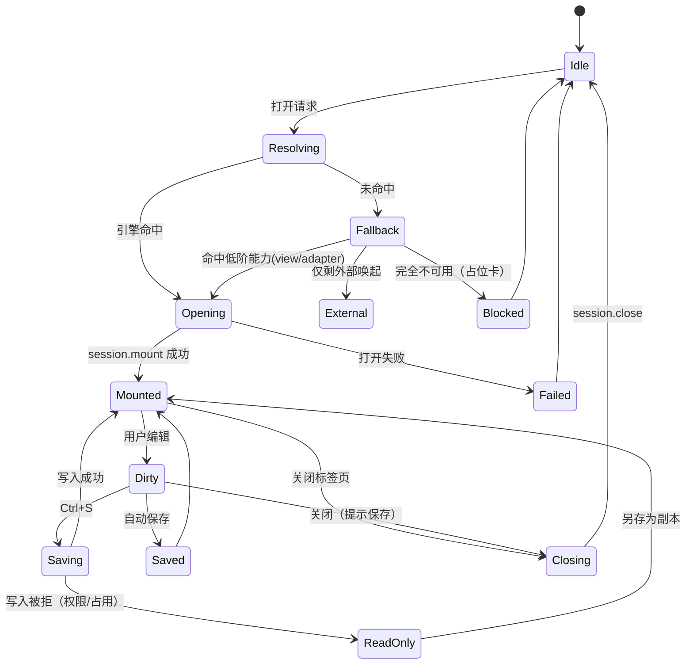

### 8.2 索引状态机

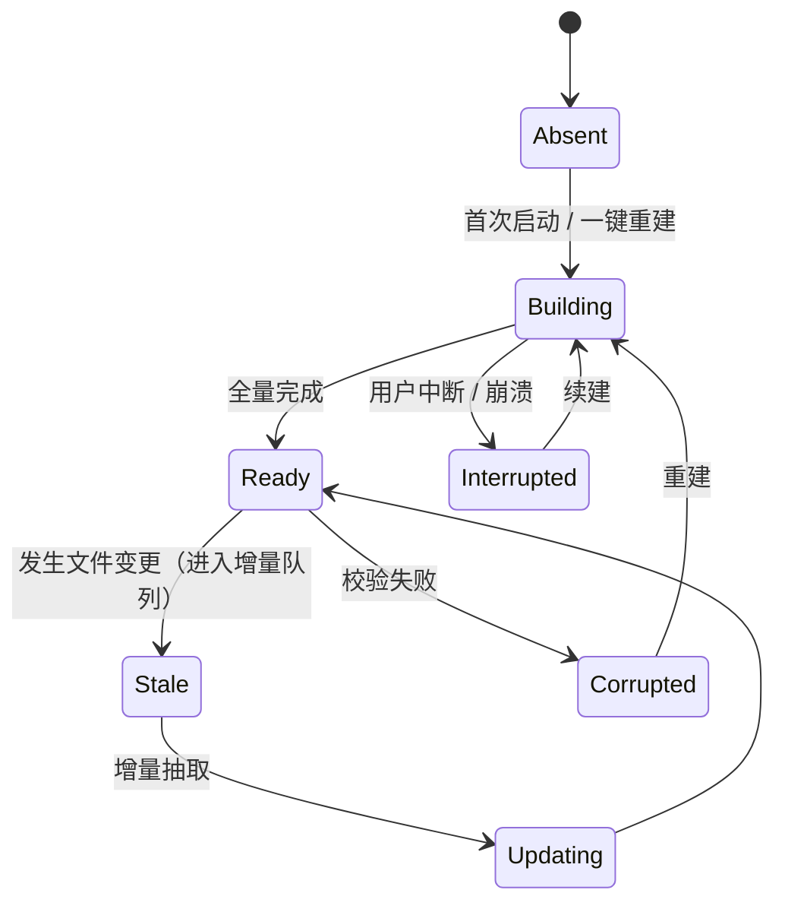

### 8.3 引用状态机

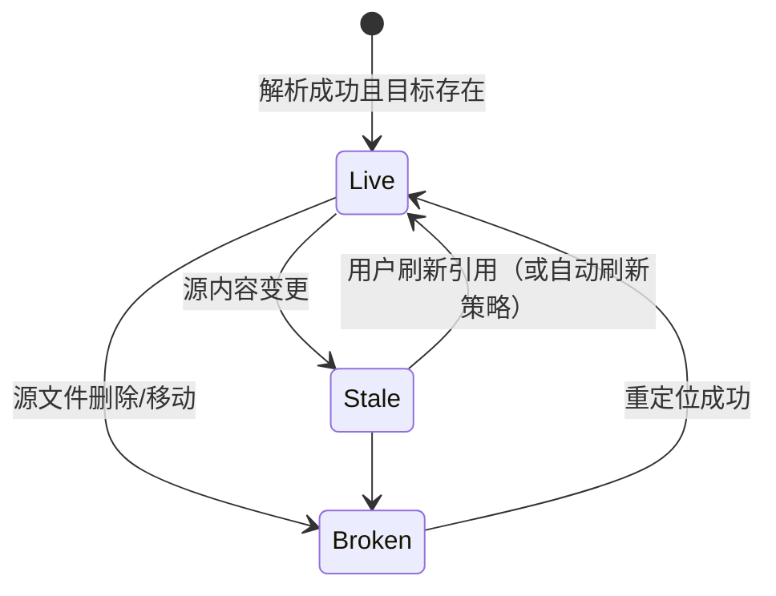

---

## 9. 接口契约

### 9.1 Cordis 服务契约（TypeScript）

```ts
// ── 已有【文档】 ───────────────────────────────────────────────────
interface RepoService {
  list(dir: string): Promise<FileNode[]>
  read(path: string): Promise<Uint8Array>
  write(path: string, data: Uint8Array): Promise<void>
  watch(dir: string): Disposable
}

type FormatExt = '.docx' | '.xlsx' | '.pptx' | '.pdf' | '.fdoc' | '.base'
type Capability = 'edit-native' | 'edit-adapter' | 'view'

interface EngineRegistry {
  register(engine: DocEngine): Disposable
  resolve(ext: FormatExt, want: Capability): DocEngine | undefined
}

interface DocEngine {
  id: string
  formats: Array<{ ext: FormatExt; capability: Capability }>
  open(ctx: Context, file: FileRef): Promise<EditorSession>
}

interface EditorSession {
  mount(el: HTMLElement): void
  save(): Promise<void>
  close(): Promise<void>
  onDirty(cb: () => void): Disposable
}
```

```ts
// ── 新增【补充】 ─────────────────────────────────────────────────────
type ExtractCapability = 'extract' | 'read-only'
type PluginState = 'discovered' | 'active' | 'degraded' | 'unloaded'

interface ExtractorEngine {
  id: string
  formats: Array<{ ext: FormatExt; capability: ExtractCapability }>
  extract(ctx: Context, file: FileRef): Promise<ExtractResult>
}

interface ExtractResult {
  text: string                       // 纯文本（供全文索引）
  title?: string
  anchors: Anchor[]                  // 位置映射，供"跳到原文精确位置"
  meta?: Record<string, string>      // 格式特有元信息（页数/工作表/节点标签）
}

interface Anchor {
  anchorId: string
  kind: 'heading' | 'cell' | 'range' | 'slide' | 'para' | 'record' | 'node' | 'codeblock' | 'listitem'
  locator: string                    // 例：Sheet1!B2 / p:7 / rec_01 / node_3f2
  text: string                       // 上下文片段
  bbox?: [number, number, number, number]  // 图形类格式的可视区域
}

interface LinkService {
  parse(ctx: Context, doc: FileRef): Promise<LinkEdge[]>   // 解析出链
  backlinks(path: string): Promise<Backlink[]>
  related(path: string, depth: number): Promise<GraphEdge[]>
  resolve(target: string, anchorId?: string): Promise<{ path: string; locator?: string } | null>
  markStale(changedPath: string): Promise<number>           // 源变更 → 标记下游 stale
}

interface SearchService {
  query(q: string, filter: SearchFilter): Promise<SearchHit[]>
  reindex(scope?: { pathPrefix?: string }): Promise<void>
  status(): Promise<IndexStatus>
  stats(): Promise<{ docs: number; bytes: number; lastBuiltAt: number }>
}

interface GitService {
  status(): Promise<GitStatus>
  commit(message: string, paths?: string[]): Promise<{ hash: string }>
  log(opts?: { path?: string; limit?: number }): Promise<Commit[]>
  diff(ref: string, path?: string): Promise<DiffResult>
  restore(ref: string, opts?: { path?: string }): Promise<{ hash: string }>
  init(opts?: { branch?: string }): Promise<void>
}

interface PluginService {
  list(): Promise<PluginRecord[]>
  install(pkgPath: string): Promise<PluginRecord>
  uninstall(id: string): Promise<void>
  diagnostics(id: string): Promise<{ ok: boolean; errors: string[]; logPath?: string }>
}
```

### 9.2 Tauri 命令清单

| 命令组 | 命令 | 入参 | 出参 | 来源 |
| :-- | :-- | :-- | :-- | :-- |
| 文件 | `fs_list` | `dir` | `FileNode[]` | 【文档】 |
| 文件 | `fs_read` | `path` | `Uint8Array` | 【文档】 |
| 文件 | `fs_write` | `path, data` | `ok` | 【文档】 |
| 文件 | `fs_rename` / `fs_remove` | `path` | `ok` | 【文档】 |
| 文件 | `fs_stat` / `fs_copy`【补充】 | `path` | 元信息 / `ok` | 引用与外跳需要 |
| 监听 | `watch_start` / `watch_stop` | `dir` | — / `ok` | 【文档】 |
| 监听 | — | — | 事件 `repo://changed` | 【文档】 |
| Sidecar | `sidecar_start` / `sidecar_stop` / `sidecar_status` | `port?` | `port/url` | 【文档】 |
| 检索 | `search_index` / `search_query` | 范围 / 查询 | 进度 / 命中 | 【文档】 |
| 检索 | `search_stats` / `search_rebuild`【补充】 | — | 统计 / 任务句柄 | 状态栏与设置页 |
| 设置 | `settings_get` / `settings_set` | 键值 | 值 | 【文档】 |
| Git | `git_status` / `git_commit` / `git_log` / `git_diff` / `git_restore` / `git_init`【补充】 | 见 §9.1 | 见 §9.1 | 补 P0 缺口 |
| 链接 | `link_scan` / `link_backlinks` / `link_related`【补充】 | 路径 | 边集合 | 补 P0 缺口 |
| 插件 | `plugin_list` / `plugin_install` / `plugin_uninstall` / `plugin_diagnostics`【补充】 | id/路径 | 清单 | 补 P1 缺口 |

> 所有命令遵循同一约定：**入参先做路径规范化（resolve → 归一 → 前缀比对），任何越界路径返回 `E_SCOPE` 而非执行**。

### 9.3 错误码

| 码 | 含义 | UI 表现 |
| :-- | :-- | :-- |
| `E_SCOPE` | 路径越界工作区 | 阻断 + 记录安全日志 |
| `E_NOT_FOUND` | 文件/目标不存在 | 引用条标记失效 + 重定位 |
| `E_LOCKED` | 文件被占用/只读 | 只读横幅 + 另存副本 |
| `E_ENGINE_LOAD` | 插件装载失败 | 占位卡 + 日志入口 |
| `E_PARSE` | 格式解析失败 | 降级为纯文本预览 + 原文下载 |
| `E_INDEX` | 索引不可用/损坏 | 搜索页错误态 + 一键重建 |
| `E_GIT` | Git 冲突/无仓库/锁 | 时间线页错误态 + 引导初始化 |
| `E_TIMEOUT` | sidecar 健康检查超时 | 自动重启 + 降级外跳 |

---

## 10. 插件运行时与安全

### 10.1 插件形态

| 形态 | 载体 | 适用 | 备注 |
| :-- | :-- | :-- | :-- |
| 内置包（monorepo） | pnpm workspace 的 TS 包 | 官方内置插件 | 架构 §4 的默认分发方式 |
| 本地动态库 | `.dll/.so/.dylib` | 第三方重型编辑器（如 OnlyOffice 桥、重型抽取器） | 对应需求 P1「运行时动态库」 |
| 安装包 | 压缩包 + 清单 | 社区插件 | 安装时校验哈希与权限声明 |

### 10.2 安全要求

| 项 | 要求 |
| :-- | :-- |
| 路径 | 所有 fs 命令经 `normalize + starts_with(workspace)` 校验；拒绝 `..`、符号链接越界、UNC 越权 |
| 静态服务 | 插件内置 web 包（如 wasm 预览）走 `127.0.0.1` 微型静态服务，**必须带一次性 token**，并做路径穿越防护 |
| 权限声明 | 插件清单声明所需能力（`fs:read` `fs:write` `net` `proc`），安装时展示并由用户确认；`net` 默认拒绝 |
| 隔离 | 插件异常不扩散；崩溃写隔离日志；sidecar 崩溃自动重启（架构 §5） |
| 数据外流 | 无出网路径；如未来开启，仅允许插件更新检查与可选 Git remote |
| 供应链 | 记录插件来源、版本、SHA-256；未知来源插件显著提示 |

### 10.3 失败与降级矩阵

| 故障 | 检测 | 降级 | 用户可见 |
| :-- | :-- | :-- | :-- |
| 插件未安装 | 注册表无匹配 | 外部唤起 / 占位卡 | 占位卡 + 安装按钮 |
| 插件装载异常 | `plugin/state-changed` | 隔离该引擎 | 占位卡 + 日志 |
| sidecar 崩溃 | 健康检查失败 | 连续重启 3 次后转外跳 | 状态栏警示 |
| 抽取失败 | `extract` 抛错 | 该文件仅入库路径与标题，不入正文 | 搜索页标注「正文未索引」 |
| 索引损坏 | 校验失败 | 一键重建（可从 `.index/` 快照恢复） | 搜索页错误态 |
| Git 冲突 | `git_status` 报冲突 | 暂停自动快照 | 标题栏冲突徽标 |

---

## 11. 索引与检索详细设计

### 11.1 抽取管线

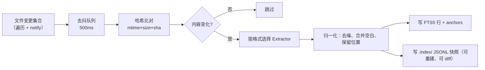

### 11.2 锚点与「跳到原文精确位置」

- 抽取器负责产出 `anchors[]`：`{ anchorId, kind, locator, text, bbox }`。
- 索引行内保存 `anchors_json` 与正文文本的**分段对应**（段落号 → 文本区间），命中后可反查「命中所在段 → anchor」。
- 前端收到 `SearchHit` 后即可给出：文档路径、定位串（如 `Sheet1!B2`、`p:7`）、上下文片段，并在渲染层请求引擎 `locate(anchorId)` 定位（引擎可选实现；未实现则退化为文本搜索定位）。

### 11.3 性能预算（需求 §6）

| 指标 | 目标 | 设计手段 |
| :-- | :-- | :-- |
| 1 万文档全文检索 | < 500ms | FTS5 前缀索引 + 过滤下推 + 结果分页；命中上下文用 `snippet()` 截取，避免全量加载 |
| 冷启动 | < 2s | 首屏只加载文件树与最近打开；索引在后台增量推进；引擎按需装载 |
| 定时扫描磁盘 | 单独进程 | 扫描器独立进程/低优先级线程，节流 + 哈希去重，避免与前台争 CPU |
| 索引可重建 | 必须 | `.index/` 快照 + 一键重建，路径与步骤可审计 |

---

## 12. 双链与跨格式引用详细设计

### 12.1 链接语法与解析

| 语法 | 示例 | 解析结果 |
| :-- | :-- | :-- |
| Wiki 链接 | `[[方案.pptx#p:7]]` | 出链（语法 wikilink）+ 锚点 `p:7` |
| 标题双链 | `[[周报#结论]]` | 出链 + 锚点 `heading:结论` |
| @ 引用 | `@台账.xlsx#Sheet1!B2` | 出链（语法 at）+ 单元格锚点 |
| 嵌入引用 | 引用块（引擎生成） | 出链（语法 embed）+ 快照内容 |

**解析时机**：双源触发——
1. **写入期**：引擎保存时把解析结果一并上报（增量、准确）；
2. **扫描期**：外部工具改动文件后，由 `core:link` 读取重解析（兜底）。

两者以 `mtime+hash` 做幂等，冲突时以扫描期为准（反映磁盘真实状态）。

### 12.2 引用实体与变更传播

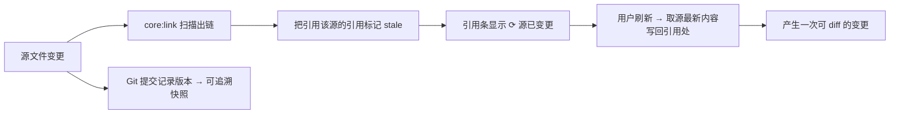

- 快照内容随引用一起保存（Git 可 diff），支持「按快照对比源变更」。
- 失效（源删除/改名）→ `broken`，提供「重定位」与「转为纯文本快照」两个出口。

### 12.3 关系图谱数据

- 节点：`Document`（可带标签、格式、度数）；边：`Link`（含方向与状态）。
- 规模保护：默认深度 2；节点数超阈值（默认 500）时改用「按度数裁剪 + 聚类提示」，避免卡顿。

---

## 13. Git 集成详细设计

### 13.1 命令与策略

| 能力 | 实现 | 策略 |
| :-- | :-- | :-- |
| 状态 | `git_status` | 仅工作区作用域，忽略 `.index/`（除非用户选择纳入） |
| 提交 | `git_commit` | `Ctrl+S` 在文档区 = 保存；在工作区 = 打开提交面板（见 §17 D-8 待确认） |
| 自动快照 | 调度器 + 空闲检测 | 默认 10 分钟或空闲 60s；跳过仅索引变动 |
| 日志 | `git_log` + `commits` 缓存表 | 首次拉取全量，之后增量 |
| diff | `git_diff` | 文本类逐行；二进制类给出结构化摘要 |
| 回滚 | `git_restore` | **生成新提交而非 reset**，历史不丢，符合 Git 安全约束 |
| 远端 | 可选 | 仅当用户配置私有 remote；默认无 remote，离线可用 |

### 13.2 与索引的隔离

- `.index/` 目录默认写入 `.gitignore`（避免快照污染 diff），但**保留**在库内以满足「索引随库储存、可重建」（需求 §1 / §6）。
- 若用户选择「索引纳入版本管理」，则只纳入 JSONL 快照，不纳入 SQLite 二进制。

---

## 14. 数据流汇总（按格式）

| 格式 | 打开 | 编辑 | 保存 | 抽取（索引） | 锚点 |
| :-- | :-- | :-- | :-- | :-- | :-- |
| `.docxxml` | `fs_read` → 反序列化 → TipTap | 块编辑 | 序列化写回（pretty JSON，Git diff 友好） | 内建解析器 | 块 id |
| `.base` | 导入器解析 → 多维表格 | 记录编辑 | 导出器生成 `.base` | 导入器解析 | 记录 id |
| `.xlsx/.pptx/.docx` | 引擎读取磁盘文件（OOXML 原生内核） | 元素级编辑 | 原子替换写回 | 专用抽取器 | 单元格/页/章节 |
| `.pdf` | `fs_read` → pdf.js | 只读 | — | pdf 文本层解析 | 页码 |
| `.md` | `fs_read` → 块解析 | WYSIWYG 块编辑 | 写回 | 内建解析器 | 标题/代码块/列表项 |
| `.drawio/.vsdx` | 只读抽取 | ❌ | — | 只读适配器 | 节点 id |

---

## 15. 工程结构建议【补充】

```text
Migrant-Knowledge-Vault/
├─ apps/
│  ├─ desktop/                 # Tauri 2 壳（Rust）
│  │  ├─ src-tauri/src/commands/{fs,watch,sidecar,search,git,settings,plugin}.rs
│  │  └─ src-tauri/tauri.conf.json
│  └─ ui/                      # React UI（Vite）
├─ packages/
│  ├─ core/                    # Cordis 内核封装 + host/client 类型扩展
│  ├─ ui-kit/                  # 设计令牌与基础组件（Miro 规范落地）
│  ├─ plugins/
│  │  ├─ repo/  search/  link/  git/  ui-shell/
│  │  ├─ engine-md/ engine-block/ engine-base/ engine-pdf/
│  │  ├─ engine-deck/ engine-word/ engine-grid/
│  │  ├─ engine-onlyoffice/
│  │  └─ extract-drawio/ extract-visio/
├─ docs/
│  ├─ 本地个人知识库-需求描述.md
│  ├─ mkv-architecture.md
│  └─ design/                  # 本设计集
└─ cordis.yml                 # 插件装配配置（架构 §3.2）
```

> 与架构 §4 的 `packages/plugins/*` 保持一致，仅补充 `apps/` 分层以区分「壳 / UI / 插件」三类可独立构建物。

---

## 16. 里程碑 → 设计项映射

| 阶段 | 内容（架构 §7） | 本设计对应 | 验收补充 |
| :-- | :-- | :-- | :-- |
| M0 | 脚手架：Tauri2 + React + Cordis + workspace，cordis.yml 驱动加载 | §3 分层、§5 插件生命周期、§9 契约、§15 结构 | 插件可加载/卸载/热替换；`resolve` 分级返回正确引擎 |
| M1 | `core:repo` + `core:engine-pdf` + ui-shell | P-1/P-2 线框、§6.1/6.2 时序、§9.2 命令 | 文件树 + PDF 查看 + 监听刷新（含自写回环去重） |
| M2 | `core:engine-onlyoffice` sidecar | §6.1 打开分支、§10 sidecar 隔离、§10.3 降级 | docx/xlsx/pptx 打开-编辑-保存闭环；崩溃重启；外跳降级 |
| M3 | `core:engine-block` | §14 数据流、§4.2 能力矩阵 | `.docxxml` 创建/编辑/保存，与飞书块结构往返一致 |
| M4 | `core:engine-base` + search + 打磨 | §11 索引与检索、§12 双链、§13 Git | 多维表格 + 全文检索；**补齐 `core:link` 与 `core:git` 才能达成 P0** |

---

## 17. 风险与待决项

| # | 问题 | 证据 | 影响 | 建议 | 建议 ADR |
| :-- | :-- | :-- | :-- | :-- | :-- |
| D-1 | 智能文档扩展名不一致：需求用 `.docxxml`，架构 `FormatExt` 用 `.fdoc` | 需求 §4 vs 架构 §3.3 | 类型契约与引擎注册错位 | **统一为 `.docxxml`**（与飞书 docxXML 语义一致），`.fdoc` 保留为兼容别名 | ADR-0004 |
| D-2 | 索引位置冲突：需求要求「随库储存于 `.index/`」，架构要求「SQLite 存 app data，非工作区」 | 需求 §1/§6 vs 架构 §5 | 可移植性与性能不可兼得 | **双层策略**：`.index/` JSONL 快照（Git 友好、可重建）+ app data SQLite 缓存（可随时重建） | ADR-0005 |
| D-3 | 格式数量不一致：P0 写「八种格式」，§4 矩阵仅 5 行且缺 Drawio/Visio | 需求 §3 vs §4 | 验收口径模糊 | 以 §4.2 本表为唯一矩阵（9 类，含只读抽取两类） | ADR-0004 |
| D-4 | Git 能力在架构插件清单与 Rust 命令组中缺失，但属 P0 | 架构 §4/§5 vs 需求 §3 | P0 无法验收 | 新增 `core:git` 插件 + `git_*` 命令组（§9.2） | ADR-0006 |
| D-5 | 双链/反链/图谱/文本抽取无对应插件与契约 | 架构 §4 vs 需求 §3/§5 | P0 双链不可交付 | 新增 `core:link` 与 `ExtractorEngine` 契约（§9.1） | ADR-0006 |
| D-6 | 插件形态未定：monorepo 内置包 vs 运行时动态库 | 架构 §4 vs 需求 P1「均为运行时动态库」 | 生态与打包体积 | **分层**：官方内置走 monorepo；重型/第三方走本地动态库 + 安装包；统一 `PluginService` 装配 | ADR-0007 |
| D-7 | OnlyOffice：AGPL v3 + 安装包 +1~2GB | 架构 §5/§8 | 分发与体验成本 | 默认用轻量 DTO 引擎（deck/word/grid）覆盖主场景，OnlyOffice 作为**可选**重插件 | ADR-0008 |
| D-8 | `Ctrl+S` 语义冲突：需求 §5.5「手动提交（Ctrl+S）」 vs 常规「保存文档」 | 需求 §5.5 | 心智冲突、易误提交 | 建议：**文档区 Ctrl+S = 保存**；提交走标题栏按钮或 `Ctrl+Shift+S` | ADR-0009 |
| D-9 | CI 门禁与当前技术定调不一致：`.github/workflows/ci.yml` 仍构建 `cargo build --workspace`、跑 `packages/core/examples/regex_fuzz_*`，而仓库内已无 Rust 源码 | `.github/workflows/ci.yml` | CI 必红，无法作为门禁 | 重写为：Node 侧 `pnpm lint + pnpm test + pnpm build`（+ 可选 Tauri 构建）；正则差分对拍随自研引擎落位后再挂 | ADR-0010 |
| D-10 | 平台支持：需求要求 Windows，CI 仅 ubuntu | 需求 §6 vs ci.yml | Windows 专属问题无门禁 | 增加 `windows-latest` 作业（构建 + 冒烟） | ADR-0010 |
| D-11 | 需求「八种格式原地预览」与「无内置解析器」并存的可行性 | 需求 §3 P0 vs P1 决策 D1 | 未装插件即无法预览，与 P0 冲突 | 明确：P0 的「预览」由**只读抽取适配器**兜底（宿主零内置解析，但仍能出纯文本预览） | ADR-0007 |

> 上表「建议 ADR」编号为本设计建议，**本文未创建 ADR 文件**；如采纳，按项目 ADR 模板在 `docs/adr/` 逐条落盘。

---

## 18. 需求 → 设计追踪矩阵

| 需求条目 | 设计位置 | 验收方式 |
| :-- | :-- | :-- |
| §1 本地优先（离线可用、不降级） | §2、§10.2 | 断网启动与全流程走查 |
| §1 文件优先（原生文件可被外部工具打开） | §14 数据流 | 用外部 Office/文本工具直接打开库内文件 |
| §1 Git 优先（索引与本体分离、可重建） | §7.3、§13.2、§11 | 删除 `.index/` 后一键重建成功 |
| §3 P0 统一知识入口 | 原型 P-1/P-2；§6.1 | 单窗口完成导入与浏览 |
| §3 P0 全文检索 + 命中跳转 | §11、§9.1 `SearchService` | 1 万文档检索 < 500ms；点击命中定位到锚点 |
| §3 P0 多格式预览 | §4.2 矩阵、§10.3 降级 | 逐格式截图核对；缺插件时降级路径可走通 |
| §3 P0 双链 + 反链 + 图谱 | §12、§9.1 `LinkService` | 建链→反链出现→图谱呈现→失效标记 |
| §3 P0 Git 版本 | §13、§9.2 `git_*` | 自动快照/手动提交/diff/回滚四步闭环 |
| §3 P1 跨格式引用 | §12.2、§14 | 引用源变更→引用处标记→刷新产生 diff |
| §3 P1 标签/元数据检索 | §9.1 `SearchFilter`、原型 P-5 | 多维过滤组合与结果计数一致 |
| §3 P1 外部唤起 + 可独立更新插件 | §10.1、§9.1 `PluginService` | 插件安装/卸载/热替换；外跳兜底 |
| §5.2 过滤：格式/标签/路径/时间 | §9.1 `SearchFilter` | 四类过滤器组合测试 |
| §5.4 统一预览/编辑容器 | §3.1、§9.1 `EditorSession` | 各格式在同一容器内切换，布局不变 |
| §6 可观测 | §5.2 事件、§10.3 | 索引重建与 Git 操作均有进度与失败提示 |
| §6 安全 | §10.2 | 路径穿越用例全部被 `E_SCOPE` 拒绝 |
| §7 边界（不做 Web/协同/云端） | §2、§5.1 | 产物为纯桌面应用；无云端入口 |
