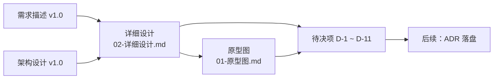

# MKV 设计集（原型图 + 详细设计）

> **Migrant Knowledge Vault · Design Set v1.0**
> 输入：[`../本地个人知识库-需求描述.md`](../本地个人知识库-需求描述.md) v1.0 · [`../mkv-architecture.md`](../mkv-architecture.md) v1.0（设计定稿）

---

## 0. 直接看图

| 入口 | 说明 |
| :-- | :-- |
| [`index.html`](./index.html) | **图索引**：全部 34 张图的清单与链接（浏览器直接打开） |
| [`prototype.html`](./prototype.html) | **原型图册**：设计令牌 + 信息架构 + 11 页线框 + 状态矩阵 + 交互流程 + 视觉规范 + 快捷键 |
| [`detailed-design.html`](./detailed-design.html) | **详细设计图册**：系统上下文 + 分层架构 + 插件与能力矩阵 + 关键时序 + 领域模型 + 状态机 + 契约 + 安全 + 待决项 |
| [`svg/`](./svg/) | 34 张独立 SVG（`p01..p11` 原型线框 · `fig-01..fig-23` 设计图），可直接插入文档 / PR / 幻灯片 |

> 三份 HTML 均为**自包含单文件**（图形内联、零外部依赖），双击即可离线查看；每张图另提供独立 SVG 下载。

---

## 1. 本目录是什么

| 文件 | 类型 | 内容 | 主要读者 |
| :-- | :-- | :-- | :-- |
| [`01-原型图.md`](./01-原型图.md) | **原型图（可编辑源）** | 信息架构、11 个页面线框、页面状态矩阵、6 条交互流程、Miro 视觉规范、快捷键 | 产品 / 交互 / 前端 |
| [`02-详细设计.md`](./02-详细设计.md) | **详细设计图（可编辑源）** | 系统上下文与分层架构、组件与能力矩阵、关键时序、领域模型与索引表、状态机、接口契约、插件与安全、索引/双链/Git 细节、风险与待决项、需求追踪矩阵 | 架构 / 前端 / 插件作者 |
| [`prototype.html`](./prototype.html) | **原型图册（渲染产物）** | 上述原型内容的图形化版本 | 产品 / 交互 / 前端 |
| [`detailed-design.html`](./detailed-design.html) | **详细设计图册（渲染产物）** | 上述详细设计内容的图形化版本 | 架构 / 前端 |
| [`index.html`](./index.html) | 图索引 | 全部 SVG 清单 | 全体 |
| [`svg/`](./svg/) | 图形资产 | 34 张独立 SVG | 全体 |
| [`tools/`](./tools/) | 生成工具 | 线框生成 / mermaid 渲染 / HTML 组装 / SVG 校验 | 维护者 |
| `README.md` | 索引 | 阅读顺序、图例、令牌速查、权威性说明 | 全体 |

**阅读顺序**

> 建议先读「详细设计」的 §4 能力矩阵与 §17 待决项，再读「原型图」；待决项会改变部分页面呈现。

---

## 2. 图例与约定

### 2.1 图的类型

| 图形 | 含义 | 出处 |
| :-- | :-- | :-- |
| 线框（ASCII 框图） | 低保真界面原型 | 01 §4 |
| `graph TD/LR` | 结构 / 依赖 / 数据流图 | 01 §2/§6、02 §2/§3/§11/§12 |
| `sequenceDiagram` | 交互与调用时序 | 01 §6、02 §6 |
| `stateDiagram-v2` | 生命周期与状态机 | 02 §5.1、§8 |
| `erDiagram` | 领域数据模型 | 02 §7.1 |

### 2.2 标注约定（02 文档）

| 标记 | 含义 |
| :-- | :-- |
| 【文档】 | 直接来自输入文档的既定内容 |
| 【补充】 | 本设计为闭合需求新增的内容，**须评审确认** |

### 2.3 术语速查

| 术语 | 一句话 |
| :-- | :-- |
| 引擎 Engine | 为某格式提供「渲染 / 编辑」能力的插件 |
| 抽取器 Extractor | 只读解析格式、产出纯文本与位置锚点的插件 |
| 会话 EditorSession | 一次文档打开的运行时实例 |
| 锚点 Anchor | 文档内可定位位置（`#Sheet1!B2`、`#p:7`、`#结论`） |
| 引用 Reference | 指向其他文档/锚点的动态引用（含快照与变更状态） |

---

## 3. 设计令牌速查（Miro Design System）

| 类别 | 令牌 | 色值 / 规格 |
| :-- | :-- | :-- |
| 文本 | Near Black / Slate / Placeholder | `#1c1c1e` / `#555a6a` / `#a5a8b5` |
| 交互 | Blue 450 / Actionable Pressed / Success | `#5b76fe` / `#2a41b6` / `#00b473` |
| 描边 | Border / Ring / Input | `#c7cad5` / `rgb(224,226,232) 0 0 0 1px` / `#e9eaef` |
| 强调 | Coral / Teal / Rose / Orange / Pink / Red | `#ffc6c6` / `#c3faf5` / `#ffd8f4` / `#ffe6cd` / `#fde0f0` / `#fbd4d4` |
| 强调深色 | Coral Dark / Teal·Moss Dark / Yellow Dark | `#600000` / `#187574` / `#746019` |
| 字体 | 显示 Roobert PRO Medium / 正文 Noto Sans | Hero 56 · 区块 48 · 卡片 24 · 正文 16–18 · 微标 10.5 |
| 圆角 | 按钮 8 / 卡片 10–12 / 面板 20–24 / 大容器 40–50 | px |
| 断点 | 425 · 576 · 768 · 896 · 1024 · 1200 · 1280 · 1366 · 1700 · 1920 | px |

规范全文见 [`01-原型图.md` §7](./01-原型图.md#7-视觉规范基于-miro-design-system)。

---

## 4. 权威性与已知偏差

| 项 | 说明 |
| :-- | :-- |
| 架构定调 | 以 [`../mkv-architecture.md`](../mkv-architecture.md)（v1.0 设计定稿）为准：Cordis 内核 + Tauri 2 壳 + React UI |
| 需求优先级 | 以 [`../本地个人知识库-需求描述.md`](../本地个人知识库-需求描述.md) 的 P0/P1/P2 为准 |
| 本文档集 | 原型为**低保真 + 交互流 + 视觉规范**，不含最终像素稿与可运行代码 |
| 已知冲突 | 架构文档未覆盖 Git / 双链 / 图谱三类 P0 能力、扩展名与索引位置存在不一致，共 11 项待决 → [`02-详细设计.md` §17](./02-详细设计.md#17-风险与待决项) |
| ADR | 本次**未新增 ADR 文件**；§17 已给出建议 ADR 编号，采纳后按项目 ADR 模板在 `docs/adr/` 落盘 |

---

## 5. 维护与再生成

- **可编辑源**：`01-原型图.md` / `02-详细设计.md`（含 mermaid 代码块与线框文字版）。
- **派生产物**：`svg/*.svg` 与三份 HTML 图册，由 [`tools/`](./tools/) 生成，**请勿手工编辑**。
- 改动 Markdown 中的 mermaid 后，需重跑 `tools/render-mermaid.mjs` + `tools/gen-html.mjs`；线框改动则重跑 `tools/gen-wireframes.mjs`。用法见 [`tools/README.md`](./tools/README.md)。

---

## 6. 变更记录

| 版本 | 日期 | 变更 |
| :-- | :-- | :-- |
| v1.0 | 2026-11-10 | 首版：基于需求描述 v1.0 + 架构设计 v1.0 输出原型图与详细设计图 |
| v1.0 | 2026-11-10 | 追加 SVG / HTML 图格式产物：11 张原型线框 SVG + 23 张设计图 SVG + 3 份自包含 HTML 图册 + 生成工具 |

